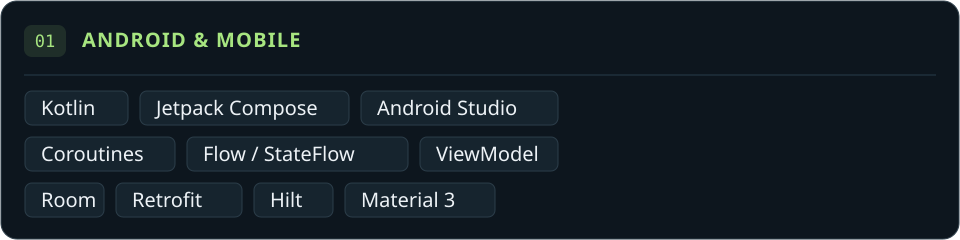
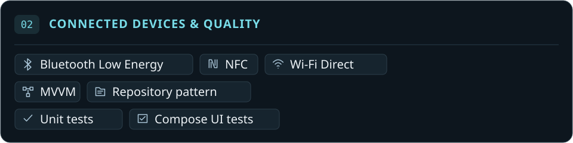
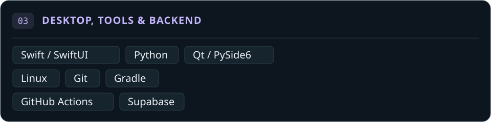
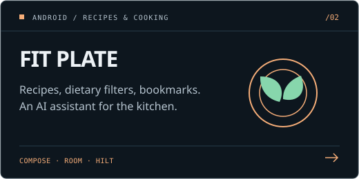
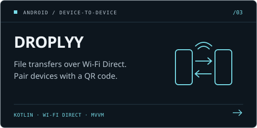
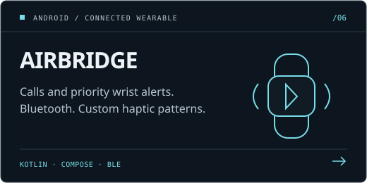

  

  
  
  

I’m Ashutosh. I build native apps with **Kotlin, Jetpack Compose and SwiftUI**—from recipe discovery and offline file sharing to desktop utilities and a growing-tree focus timer.

Exploring how **hardware connects with software** through **Android Automotive, IoT, drones and robotics**.

## Technical skills

  
  
  

## Featured projects

<table>
  <tr>
    <td width="50%" valign="top">
      
      
A focus timer that grows a tree as you work. Includes Pomodoro rounds, a floating timer, session history, light/dark themes and cross-device sync.

      
<a href="https://github.com/ashu-sa/focanopy/releases/latest">Download</a> · <a href="https://github.com/ashu-sa/focanopy/blob/main/docs/DEMOS.md">Demos</a> · <a href="https://github.com/ashu-sa/focanopy">Code</a>

    </td>
    <td width="50%" valign="top">
      
      
A recipe app with dietary filters, saved recipes and an AI cooking assistant. Uses Compose, Hilt, Retrofit and Room-backed local bookmarks.

      
<a href="https://github.com/ashu-sa/Fit-Plate">Screens & demo</a> · <a href="https://github.com/ashu-sa/Fit-Plate">Code</a>

    </td>
  </tr>
  <tr>
    <td width="50%" valign="top">
      
      
Share files directly between Android devices without an internet connection. Uses Wi-Fi Direct for transfers and QR codes for device pairing.

      
<a href="https://github.com/ashu-sa/Droplyy#screenshots">Screenshots</a> · <a href="https://github.com/ashu-sa/Droplyy">Code</a>

    </td>
    <td width="50%" valign="top">
      
      
An Android Automotive dashboard with driving screens, vehicle telemetry and simulation controls. Includes CarPropertyManager integration and mock vehicle-data sources.

      
<a href="https://github.com/ashu-sa/AuraDrive">Explore the code</a>

    </td>
  </tr>
  <tr>
    <td width="50%" valign="top">
      
      
A macOS clipboard utility with a floating panel, pinned clips, file staging and keyboard shortcuts. Built with SwiftUI and AppKit.

      
<a href="https://github.com/ashu-sa/QuickClip">Preview</a> · <a href="https://github.com/ashu-sa/QuickClip">Code</a>

    </td>
    <td width="50%" valign="top">
      
      
An independent Android app for Fitbit Air wrist alerts. Built with Kotlin and Compose, with BLE discovery, distinct haptic patterns, optional notification rules and connection recovery.

      
Separate Calls and Full editions with signed release APKs. Experimental: live alert delivery, battery use and companion-app coexistence are still being validated.

      
<a href="https://github.com/ashu-sa/AirBridge/releases/latest">Download</a> · <a href="https://github.com/ashu-sa/AirBridge#screenshots">Screenshots</a> · <a href="https://github.com/ashu-sa/AirBridge">Code</a>

    </td>
  </tr>
</table>

## Get in touch

Happy to talk about native apps, Automotive projects, or ideas that connect software to hardware.

  
  

<!-- Graphics: docs/DESIGN.md. Icon sources and license: assets/icons/README.md. -->
