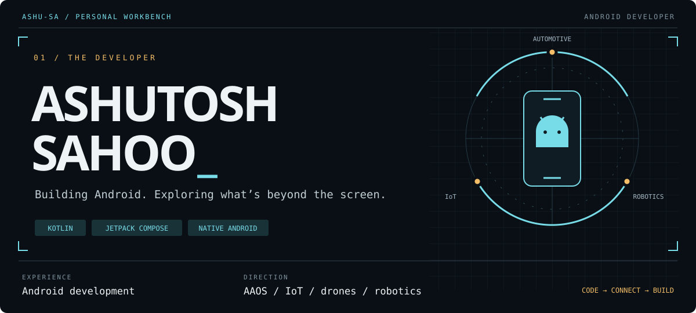

  

  <a href="https://www.linkedin.com/in/ashutosh202/">LinkedIn</a> ·
  <a href="mailto:ashutoshh202@gmail.com">Email</a> ·
  <a href="https://github.com/ashu-sa?tab=repositories">Projects</a>

I build native Android applications with **Kotlin and Jetpack Compose**, with attention to how they behave beyond the happy path: offline, in the background, and after reopening the app.

My experience is in **Android development**. I’m interested in extending that foundation into **Android Automotive OS**, **IoT**, **drones**, and **robotics**—especially the apps and interfaces that connect people to physical devices.

## Selected work

### [Focanopy](https://github.com/ashu-sa/focanopy) · An Android-first focus companion

A focus timer that turns time into a growing grove, with optional Pomodoro rounds, floating controls, a calendar journal, and cross-device session history.

- **Native Android experience:** Compose / Material 3, saved light and dark themes, and a growing-tree companion.
- **Android system integration:** foreground timing, notification controls, a draggable overlay, and optional app blocking in a separate APK edition.
- **Persistence and sync:** local history, remembered Google sign-in, and Supabase-backed session sync.
- **Delivery:** downloadable releases, GitHub Actions builds, unit tests, lint, and isolated-emulator UI checks.

  

[Code & design decisions](https://github.com/ashu-sa/focanopy) · [App walkthroughs](https://github.com/ashu-sa/focanopy/blob/main/docs/DEMOS.md) · [Try a release](https://github.com/ashu-sa/focanopy/releases/latest)

### More projects to explore

| Project | What it explores | Worth a look |
|---|---|---|
| [ProductCatalog](https://github.com/ashu-sa/ProductCatalog) | A Compose product catalog with search and an offline shopping cart | Room-backed persistence, reactive Flow state, and MVVM / repository boundaries |
| [AuraDrive](https://github.com/ashu-sa/AuraDrive) | An Android Automotive exploration project | Vehicle-data interfaces, a `CarPropertyManager` data source, and a mock source for simulation |
| [QuickClip](https://github.com/ashu-sa/QuickClip) | A native macOS clipboard and file-staging utility | SwiftUI / AppKit, a floating HUD, keyboard access, and local persistence |

## My Android toolkit

| Area | Tools and patterns used in my projects |
|---|---|
| Language & UI | Kotlin, Jetpack Compose, Material 3 |
| State & concurrency | Coroutines, Flow / StateFlow, ViewModel |
| Data | Room, Retrofit, OkHttp, local persistence |
| Structure | MVVM, repository pattern, separation of UI and data sources |
| Build & verification | Android Studio, Gradle Kotlin DSL, Git, GitHub Actions, unit and UI tests |

## Where I’m heading

I’m drawn to software that has a connection to the physical world:

- **Android Automotive:** in-vehicle experiences and turning vehicle data into useful interfaces. [AuraDrive](https://github.com/ashu-sa/AuraDrive) is an early exploration of this direction.
- **IoT and connected devices:** Android companion apps, sensor data, device status, and control interfaces.
- **Drones and robotics:** telemetry, monitoring, and human–machine interaction.

These are areas I want to grow into, building on my Android experience.

## Let’s connect

I’m interested in Android opportunities and conversations with people building automotive or connected-device software.

[LinkedIn](https://www.linkedin.com/in/ashutosh202/) · [ashutoshh202@gmail.com](mailto:ashutoshh202@gmail.com)
