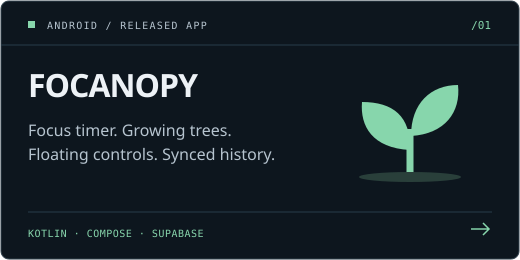
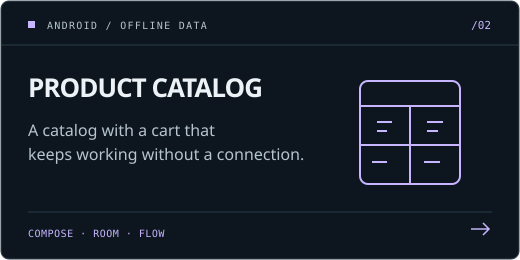
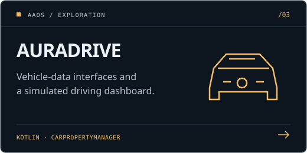
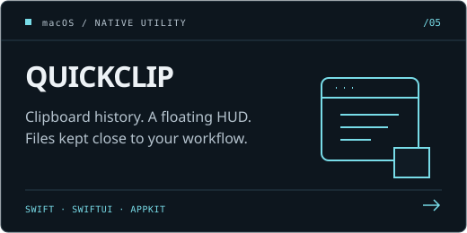
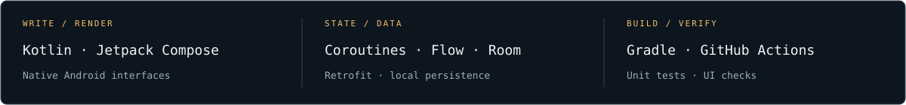

  

  <a href="https://www.linkedin.com/in/ashutosh202/">LINKEDIN ↗</a> &nbsp; / &nbsp;
  <a href="mailto:ashutoshh202@gmail.com">EMAIL ↗</a> &nbsp; / &nbsp;
  <a href="#the-builds">THE BUILDS ↓</a>

I build Android apps with **Kotlin + Jetpack Compose**. Lately: a growing-tree focus timer, an offline shopping cart, and an Automotive experiment.

I’m drawn to **Android Automotive, connected devices, drones and robotics**. That’s where I want to take my Android skills next. AuraDrive is an early experiment in that direction.

## The builds

<table>
  <tr>
    <td width="50%"></td>
    <td width="50%"></td>
  </tr>
  <tr>
    <td width="50%"></td>
    <td width="50%"></td>
  </tr>
</table>

**Try Focanopy:** [Download an app](https://github.com/ashu-sa/focanopy/releases/latest) · [See the demos](https://github.com/ashu-sa/focanopy/blob/main/docs/DEMOS.md) · [Inspect the build checks](https://github.com/ashu-sa/focanopy/actions/workflows/build.yml)

## On the workbench

The repos cover different parts of the work: background timing and system integration in **Focanopy**, offline data and reactive state in **ProductCatalog**, and vehicle-data abstractions in **AuraDrive**.

Inside the projects →

- **[Focanopy](https://github.com/ashu-sa/focanopy):** Compose / Material 3, foreground timing, notification actions, a draggable overlay, local history, Google sign-in and Supabase sync. Unit tests, lint and emulator UI checks accompany the releases.
- **[ProductCatalog](https://github.com/ashu-sa/ProductCatalog):** a searchable catalog and a Room-backed cart; Flow-based state and MVVM / repository separation.
- **[AuraDrive](https://github.com/ashu-sa/AuraDrive):** an Automotive exploration with `CarPropertyManager` and mock vehicle-data sources.
- **[QuickClip](https://github.com/ashu-sa/QuickClip):** a SwiftUI / AppKit clipboard utility with a floating HUD, keyboard access and local persistence.

---

**Building something for Android—or connecting it to the physical world?** I’d like to hear about it.

[LinkedIn](https://www.linkedin.com/in/ashutosh202/) · [ashutoshh202@gmail.com](mailto:ashutoshh202@gmail.com)

<!-- Original cockpit graphics. Research and inspiration: docs/DESIGN.md. -->
